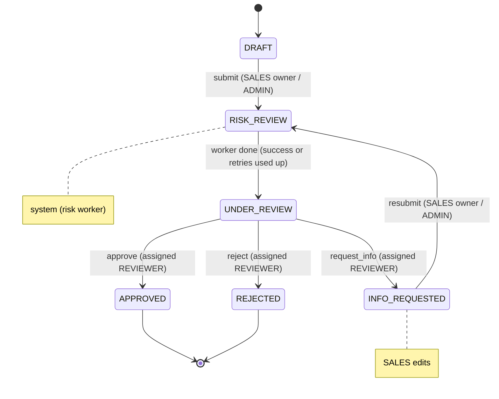

## Roles(Highest permission first):

1. SUPER_ADMIN(not implemented here)
2. ADMIN
3. REVIEWER
4. SALES


## 1. Status model

An application carries three state-related fields, each answering one question:

| Field             | Question it answers                         | Values |
|-------------------|---------------------------------------------|--------|
| `status`          | Where is the application in the workflow, and who acts next? | 1.1 |
| `kybStatus` | How far has the automated KYB/risk check got? | `NOT_STARTED`, `PENDING`, `COMPLETED`, `FAILED` |
| `kybLevel`       | What did the KYB/risk check conclude?            | `LOW`, `MEDIUM`, `HIGH`, or `null` until completed |

Users move `status` through API calls; the worker moves it out of `RISK_REVIEW`. Only the worker writes `kybStatus` and `kybLevel`.


### 1.1 Lifecycle

```
DRAFT ──submit──▶ RISK_REVIEW ──worker done──▶ UNDER_REVIEW ──approve──────▶ APPROVED
                   (system)                       (human)    ──reject───────▶ REJECTED
                      ▲                                      ──request_info─┐
                      │                                                     │
                      └──────resubmit────── INFO_REQUESTED ◀────────────────┘
                                            (SALES edits)
```

The same lifecycle in Mermaid:



| Status           | Meaning                                    | Primary actor (waiting on)        | Primary actor's actions                 | Other allowed actions                          | Editable? |
|------------------|--------------------------------------------|-----------------------------------|-----------------------------------------|------------------------------------------------|-----------|
| `DRAFT`          | Created, not yet submitted                 | SALES owner                       | edit, submit                            | ADMIN: edit, submit, transfer owner            | yes       |
| `RISK_REVIEW`    | Locked; the automated KYB check is running | system (KYB worker)               | complete the check → `UNDER_REVIEW`     | ADMIN: assign reviewer, transfer owner         | no        |
| `UNDER_REVIEW`   | KYB check finished; waiting for a decision | assigned REVIEWER                 | approve, reject, request info           | ADMIN: assign / reassign reviewer, transfer owner | no     |
| `INFO_REQUESTED` | Reviewer sent it back for changes          | SALES owner                       | edit, resubmit                          | ADMIN: edit, resubmit, reassign reviewer, transfer owner | yes |
| `APPROVED`       | Terminal                                   | —                                 | —                                       | none (read-only)                               | no        |
| `REJECTED`       | Terminal                                   | —                                 | —                                       | none (read-only)                               | no        |

**Viewing is separate from acting** and works the same in every status: the SALES owner, the
assigned REVIEWER and ADMIN can view the application (see [auth.md](auth.md)). "Editable" means the SALES owner or
ADMIN can change its fields. In `UNDER_REVIEW` with no reviewer assigned yet, ADMIN must assign one
before any decision can happen.


### 1.2 Transition table

| From             | Action          | To               | Who                    | Extra guard |
|------------------|-----------------|------------------|------------------------|-------------|
| `DRAFT`          | `SUBMIT`        | `RISK_REVIEW`    | owner SALES, ADMIN     | — |
| `INFO_REQUESTED` | `SUBMIT`        | `RISK_REVIEW`    | owner SALES, ADMIN     | — |
| `RISK_REVIEW`    | `KYB_COMPLETE` | `UNDER_REVIEW`   | system (worker) only   | job's `submission_no` = current `submission_count` |
| `UNDER_REVIEW`   | `APPROVE`       | `APPROVED`       | **assigned** REVIEWER  | `kybStatus` = `COMPLETED` |
| `UNDER_REVIEW`   | `REJECT`        | `REJECTED`       | **assigned** REVIEWER  | — |
| `UNDER_REVIEW`   | `REQUEST_INFO`  | `INFO_REQUESTED` | **assigned** REVIEWER  | — |

Operations that do not change `status`:

| Operation | Allowed in status                              | Who |
|-----------|------------------------------------------------|-----|
| `UPDATE`  | `DRAFT`, `INFO_REQUESTED`                      | owner SALES, ADMIN |
| `ASSIGN`  | `RISK_REVIEW`, `UNDER_REVIEW`, `INFO_REQUESTED` | ADMIN (target must have role REVIEWER) |
| `TRANSFER_OWNER` | any non-terminal status            | ADMIN (target must have role SALES) |

Anything not in the table returns **409 Conflict** with the error code `INVALID_STATE_TRANSITION`.
Examples: approving a `DRAFT`, deciding while still in `RISK_REVIEW`, or editing an `UNDER_REVIEW`
application. `KYB_COMPLETE` has no HTTP endpoint at all; only the worker can trigger it.

**The worker moves the application to `UNDER_REVIEW` whether the check succeeds or
fails permanently.** After the retries are used up, it moves to `UNDER_REVIEW` with
`kybStatus = FAILED`. This means an application never gets stuck in `RISK_REVIEW`.
APPROVE requires `kybStatus = COMPLETED`; approving with any other `kybStatus` (e.g.
`FAILED`) returns **409** with code `KYB_NOT_COMPLETED`. This is the one exception to
"anything not in the table returns `INVALID_STATE_TRANSITION`": the row is in the table, but
its guard failed. The reviewer can still REJECT or REQUEST_INFO; after a request info, the
resubmit starts a new KYB check. So nothing is blocked, and no extra "retry KYB check" endpoint
is needed.

**Decision details** (`POST /applications/:id/decision`):
- `note` is optional for all three decisions, trimmed, and at most 2000 characters
  (whitespace-only means no note).
- Every decision overwrites `decision_note` (with `null` when no note is given) and sets
  `decided_at`.
- REQUEST_INFO keeps `assigned_reviewer_id`, so the same reviewer gets the application back
  after the resubmit's KYB check.
- Resubmit leaves `decision_note` / `decided_at` alone until the next decision, so SALES can
  still read the request.
- The note is returned in responses but never written to audit meta or logs.
- `decision_note` is free text that the SALES owner, the assigned REVIEWER and ADMIN can all
  see. It is returned unmasked: it is not in [sensitive-data.md](sensitive-data.md)'s masked
  list. The API therefore rejects (400, without echoing the note) a note that contains the
  application's own raw `taxId` or `ownerNationalId` (compared case-insensitively, ignoring
  spaces and dashes); the last 4 digits alone are allowed. A note with a NUL character is also
  rejected with 400.

**Decisions are allowed only in `UNDER_REVIEW`.** The rule "no human decision before the KYB result" is therefore enforced by the state machine itself, not by an extra `if` that could be forgotten.

**ADMIN can assign during `RISK_REVIEW`.** A reviewer can be lined up while the check runs, and the application lands in their queue as soon as the check finishes.

**ADMIN cannot record decisions.** An ADMIN who needs to record a decision can assign the application to a reviewer.

**Full Operational Access.** An Super Admin(role not implemented yet) will have the full operation access.

### 1.3 KYB check fields

| `kybStatus` | `kybLevel` | Set when |
|-------------------|-------------|----------|
| `NOT_STARTED`     | `null`      | Application created |
| `PENDING`         | `null`      | On every SUBMIT (same transaction as the move to `RISK_REVIEW`); clears the previous result |
| `COMPLETED`       | `LOW` / `MEDIUM` / `HIGH` | Worker stored a provider result (score thresholds in config) |
| `FAILED`          | `null`      | All retry attempts were used up |

### 1.4 Progress visibility

`GET /applications/:id` returns `status`, plus a `kybCheck` block:

```json
"kybCheck": {
  "status": "COMPLETED",
  "level": "HIGH",
  "label": "Needs double check",
  "score": 78,
  "attempts": 2,
  "lastAttemptAt": "2026-10-23T09:15:00Z"
}
```

The audit trail shows each system step as an entry with `actor_type = SYSTEM` and
`actor_label = 'kyb-worker'`. Clients poll this endpoint.
_(trade-off)_ Live push (WebSocket/SSE) is out of scope.

`label` is a human-readable summary of `level`. It is **computed in the response DTO and not
stored**:

| `kybLevel` | `label`              |
|------------|----------------------|
| `LOW`      | `Good to go`         |
| `MEDIUM`   | `Fair deal`          |
| `HIGH`     | `Needs double check` |
| `null`     | `null`               |

**The label is derived, not a column.** Storing it alongside `kyb_level` would record
the same fact twice, and the two could disagree (e.g. `HIGH` + "Good to go"). Deriving it from one
mapping keeps a single source of truth, and the wording can change without a migration.

